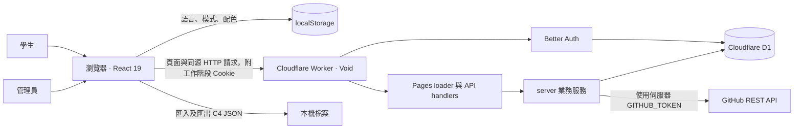
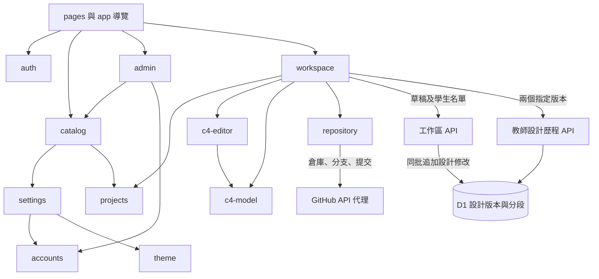
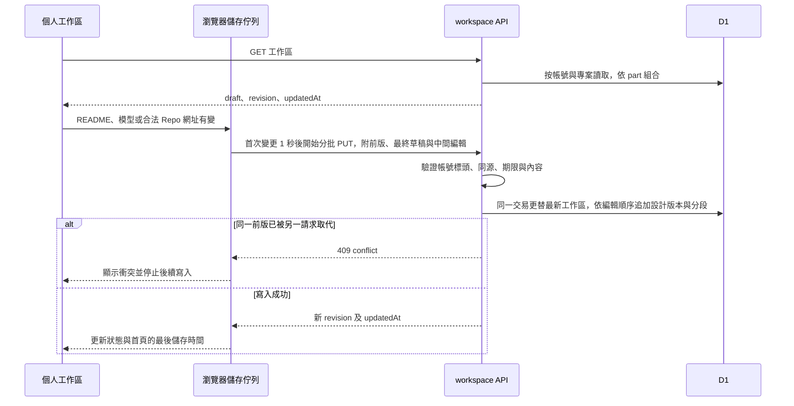
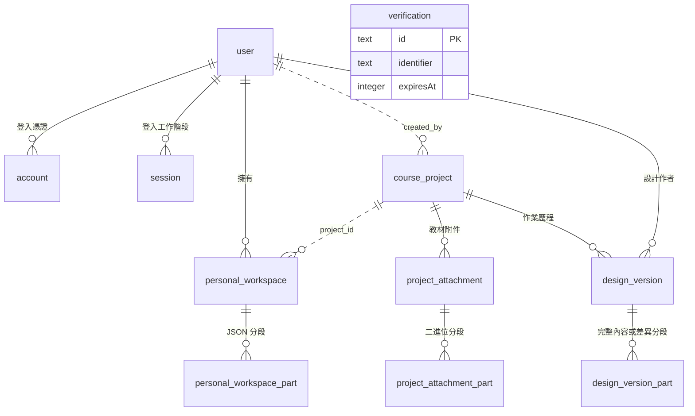

# 課程作業平台架構設計

**最近同步**　2026-11-26 已核對 README.md 與 C4 設計歷程的編輯入口、逐版儲存、教師比較介面、權限與既有資料遷移，並與 [測試清冊](Test.md) 對照。

課程作業平台（CAP）把教師發佈的作業與每個帳號的作答分開保存。管理員建立專案、上傳教材、設定截止時間。學生進入同一個專案，各自編寫 README、繪製 C4 模型、連結公開 GitHub 倉庫。首頁與管理員的學生清單都以「是否已有儲存版本」判定作業狀態。配分是題目的屬性，目前沒有批改分數或另外按鈕送出作業的流程。

本文依據 `pages/`、`routes/api/`、`src/`、`server/`、`db/` 與根目錄設定撰寫。本機的 `.test/作業成果-第16組/` 另收錄一份學生選課與成績預警系統的題目、設計說明與 C4 JSON，屬於課程交件資料。平台本身執行於瀏覽器與 Cloudflare Worker，使用 D1。各功能的測試見 [Test.md](Test.md)。

| 查閱目的                       | 對應章節                                                                                                                                                   |
| ------------------------------ | ---------------------------------------------------------------------------------------------------------------------------------------------------------- |
| 瞭解使用者、入口與程式分工     | [系統邊界](#system)、[頁面與導覽](#pages)、[模組依賴](#modules)                                                                                            |
| 追蹤一項功能從操作到儲存的行為 | [登入與帳號](#accounts)、[專案與教材](#assignments)、[工作區與繳交狀態](#workspaces)、[C4 與 README](#design)、[GitHub](#repository)、[設定](#preferences) |
| 對照程式契約與實體資料         | [HTTP 介面](#http)、[D1 資料關係](#data)、[建置與部署](#build)                                                                                             |

## 1. 系統邊界與執行位置

三個頁面都宣告 `ssr = false`，React 在瀏覽器繪製內容。Void 依檔名解析網址、執行伺服器 loader 並提供同源 API。Better Auth 和業務服務共用 D1。工作區完整內容以 D1 的最近一次成功版本為準。瀏覽器記憶體另外保存尚未寫入的變更、畫布互動、復原歷史、目前分頁及 GitHub 查詢結果。

| 使用者         | 可執行的操作及資料範圍                                                                                                                         |
| -------------- | ---------------------------------------------------------------------------------------------------------------------------------------------- |
| 訪客           | 首頁顯示登入表單。直接開啟專案或管理頁會導向首頁。`GET /api/session` 可用來判斷是否已登入。                                                    |
| 學生 `user`    | 瀏覽所有有效專案、下載教材、在截止前編輯自己的工作區、瀏覽公開倉庫，以及編輯自己的姓名、信箱和密碼。                                           |
| 管理員 `admin` | 具備自己的工作區，可於截止後繼續編輯自己的內容。管理全站專案及帳號，並可依專案查看學生名單及唯讀作業。管理員檢視學生時仍以自己的身分讀取資料。 |

## 2. 頁面、導覽與狀態

| 頁面                                          | 進入條件與載入內容                                                                                                                                                                      | 操作結果                                                                                                                                                                 |
| --------------------------------------------- | --------------------------------------------------------------------------------------------------------------------------------------------------------------------------------------- | ------------------------------------------------------------------------------------------------------------------------------------------------------------------------ |
| `/`                                           | `pages/layout.tsx` 依序建立 Theme、I18n、Auth 及 Settings Provider。`AuthGate` 等待 session，未登入顯示登入表單，讀取錯誤時提供重新載入。通過後 `ProjectCatalogProvider` 載入專案清單。 | `HomeDashboard` 顯示歡迎訊息、專案數、標題與台北截止時間。學生可見尚未開始、已儲存、最後更新與期限提示。管理員另有管理入口與每個專案的「學生專案」。首頁提供設定與登出。 |
| `/admin`                                      | `pages/admin.server.ts` 要求登入及管理員身分，一般帳號回 403。`AdminPage` 預設專案管理，可切換帳號管理。                                                                                | 兩個清單各自維護搜尋、對話框、等待及回饋狀態，可操作後返回清單或首頁。                                                                                                   |
| `/projects/:id`                               | `pages/projects/[id].server.ts` 驗證登入與有效專案，不存在或已刪除回 404。前端從目錄取專案，再依帳號讀取工作區。                                                                        | `PersonalProject` 預設自己的「作業說明」，另有「設計架構」及「Repo」。載入時顯示進度，失敗可重試。                                                                       |
| `/projects/:id?students=1` 與 `?student=<id>` | 同一頁的管理員名單與檢視模式，`usePageNavigation` 解析 query。一般帳號的畫面固定為個人模式，API 另行檢查權限。                                                                          | 管理員選學生後預設開啟「設計架構／README」。可回名單或依順序查看上一位、下一位。切換學生以 `replace` 更新網址，保留畫面狀態與捲動位置。                                  |

`SettingsDialog` 位於 `AuthGate` 外，依帳號識別重新掛載。工作區外層以「登入者／專案」為 key，實際編輯器以「專案／正在檢視的帳號」為 key，切換對象會取得新的草稿、儲存版本與編輯器狀態。`useAsyncLoad` 以請求 key、`AbortController`、載入及重試狀態避免舊回應覆蓋目前畫面。

## 3. 模組分工與依賴

下圖顯示頁面組裝以及作業、編輯器、倉庫三者的主要呼叫關係。表中列出各模組直接引用的其他功能模組，含型別匯入。程式內 `@modules/<名稱>` 指向對應目錄的 `index.ts`。

| `src/modules/`                                | 職責及主要入口                                                                                                                                                                                                                                                                          | 直接引用的其他功能模組                          |
| --------------------------------------------- | --------------------------------------------------------------------------------------------------------------------------------------------------------------------------------------------------------------------------------------------------------------------------------------- | ----------------------------------------------- |
| [auth](src/modules/auth/index.ts)             | `AuthProvider`、`AuthGate` 管理 session 與登入狀態。`useLoginForm` 處理顯示密碼、重複送出、必填與錯誤提示。`serverAuthService` 呼叫 Void 用戶端登入／登出，再讀取平台身分。                                                                                                             | i18n                                            |
| [accounts](src/modules/accounts/index.ts)     | `AccountFields`、`AccountProfileFields` 共用欄位。`EditAccountDialog` 與 `ChangeAccountPassword` 分開送出個資、密碼。`useAccountUpdate` 解析錯誤及 `signedOut`。                                                                                                                        | i18n                                            |
| [admin](src/modules/admin/index.ts)           | `AdminPage`、`ProjectList`、`AccountList`、建立表單與刪除確認。hooks 各自執行查詢、排序、提交和對話框切換。專案異動更新共用目錄，帳號異動重新讀取清單。                                                                                                                                 | accounts、catalog、i18n、projects               |
| [projects](src/modules/projects/index.ts)     | `Project`、附件中繼資料、個人作業狀態、專案欄位與附件限制。`parseProjectInput`、`deadline.ts` 封裝輸入正規化及 UTC+8 時間規則，供前後端共用。                                                                                                                                           | 無                                              |
| [catalog](src/modules/catalog/index.ts)       | `useCatalogState` 取得 `projects` 和當前使用者的 `workspaceStatuses`。`ProjectCatalogProvider` 對子頁面提供增修、移除、整批替換及標記已儲存。`HomeDashboard` 呈現目錄。                                                                                                                 | auth、i18n、projects、settings                  |
| [workspace](src/modules/workspace/index.ts)   | `PersonalProject` 決定本人／名單／唯讀學生模式。`ProjectWorkspace` 組裝教材、README、圖及倉庫。`useProjectDraft` 從文字輸入與模型操作逐次記錄內容，`workspaceApi`、`useWorkspaceAutosave`、`saveQueue` 負責傳輸與存檔。`DesignHistory` 讀取教師選取的兩個版本，並可開啟當時的唯讀圖面。 | c4-editor、c4-model、i18n、projects、repository |
| [c4-model](src/modules/c4-model/index.ts)     | 純 TypeScript 模型，`c4.ts` 計算階層、建立／刪除及幾何，`c4File.ts` 定義版本化格式、剖析、驗證與序列化。供匯入、匯出、伺服器讀寫共用。                                                                                                                                                  | 無                                              |
| [c4-editor](src/modules/c4-editor/index.ts)   | `C4Architect`、`DesignDocument`、`C4Diagram`、`C4Canvas`、`C4Inspector` 呈現設計分頁。hooks 協調範圍、繪製及檔案操作，model 子目錄轉換 React Flow 幾何、投影節點／邊與管理歷史。                                                                                                        | c4-model、i18n                                  |
| [repository](src/modules/repository/index.ts) | `RepositoryConnection` 與 `GitHubRepoDashboard` 顯示連線、統計、分支、語言、檔案樹、提交及差異。`useRepository` 協調同步與分支切換，`useRepoDashboard` 管理分頁和展開，`services/github.ts` 封裝平台 API。                                                                              | i18n                                            |
| [settings](src/modules/settings/index.ts)     | `SettingsButton`、`SettingsProvider`、`SettingsDialog` 管理視窗及單一展開區塊，提供語言、主題、配色與目前帳號編輯。                                                                                                                                                                     | accounts、i18n、theme                           |
| [i18n](src/modules/i18n/index.ts)             | `I18nProvider` 偵測／切換語言，`messages.ts` 提供型別化 key 與插值，`en/`、`zh-TW/` 各分 UI 及執行期訊息。                                                                                                                                                                              | 無                                              |
| [theme](src/modules/theme/index.ts)           | `ThemeProvider`、`model.ts` 管理模式、系統深淺色監聽、色票與文件根元素樣式。                                                                                                                                                                                                            | 無                                              |

**共用層。** `src/shared/` 提供帳號、密碼、工作區文字與 Repo URL 規則，`http/readLimitedText.ts` 以標頭和實際串流位元組限制輸入。`shared/ui` 提供按鈕、連結、卡片、徽章、表單、表格、對話框、選單、分段控制、工具提示、Markdown 與載入／錯誤回饋。`useTransientNotice` 以 3.5 秒顯示短暫結果，成功及警告用 `status`，錯誤用 `alert`。`src/app/styles/` 集中字體、設計變數、元件、捲軸與 C4 樣式。

**伺服器層。** `routes/api/` 處理 HTTP 與授權，`server/access.ts` 共用角色與同源檢查。[server/accounts](server/accounts/index.ts) 管理帳號寫入，[server/projects](server/projects/index.ts) 管理專案與附件，[server/workspaces](server/workspaces/index.ts) 使用 projects 的有效性與期限規則搭配工作區分段儲存，[server/github](server/github/index.ts) 封裝上游、快取與限流。`server/errors.ts` 辨識包在 `Error.cause` 中的唯一性錯誤。`db/schema.ts` 引用專案的資料型別與 Void 產生的驗證資料表。

**邊界如何維持。** 路由、伺服器及瀏覽器功能透過公開入口跨模組引用，模組內可直接用相對路徑。`src/shared` 僅依賴共用層及外部套件。用戶端不能匯入 D1、伺服器路由或伺服器驗證程式。領域模型不依賴 React、hooks、服務或 UI，C4 畫布轉換層可使用 React Flow。`tests/architecture.test.tsx` 掃描含型別、動態匯入與 mock 的依賴，檢查檔案與功能模組的循環。

## 4. 使用者功能與業務規則

### 4.1 登入、帳號與管理保護

1. **建立身分與登入。** 系統停用公開註冊。第一個管理員由 `scripts/prepare-admin.mjs` 以互動、命令列參數或單獨的 `--env` 接收資料，預設名稱為 Administrator。它以 Better Auth 雜湊密碼，產生 `.void/bootstrap-admin.sql`，由操作者另行套用。其餘帳號由管理員在介面建立。名稱去除首尾空白且上限 100，信箱上限 254、去空白並轉小寫，角色限 `user` 或 `admin`，密碼長度 8–16。建立 API 僅接收 `name/email/password/role`。
2. **工作階段。** 登入只需電子郵件與密碼，`studentId` 在此平台對應信箱。登入後用 HttpOnly Cookie 代表 session，`/api/session` 將有效身分投影成 `id/studentId/name/role`。頁面重新整理時取回身分。登出撤銷工作階段，已軟刪除的帳號無法建立新 session。
3. **個資與密碼。** 學生可修改自己的姓名與信箱。管理員可編輯其他帳號的角色。改自己的密碼或另一位管理員的密碼須驗證目標帳號的舊密碼。管理員重設其他學生的密碼時只接收新密碼。資料與密碼由不同 PATCH 處理，夾帶未允許的欄位會被拒絕。更新信箱會清除其驗證狀態，更新個資或密碼均撤銷目標帳號的 session。本人修改成功後回首頁重新登入。
4. **帳號清單與刪除。** 依建立時間由新到舊，支援姓名／信箱搜尋、新增、編輯與具名確認刪除。清單僅提供 ID、姓名、信箱、角色及停權狀態。刪除時在同一批次撤銷 session、將 `user.deleted` 設為真，保留 credential、工作區及內容。刪除後信箱仍受唯一索引約束。
5. **並行與角色保護。** 禁止自我刪除與自我降權。管理寫入在 SQL 條件重查操作者仍為有效管理員，刪除／降權等操作另查尚有其他可用管理員。改密碼時 batch 重新比對已驗證的雜湊，學生免舊密碼流程也重查目標身分，避免同時修改覆蓋。`auth.ts` 停用內建的個資、密碼、刪除、角色、停權、冒用與工作階段管理等替代端點，管理員建帳保留 Better Auth 的 `admin/create-user`。

### 4.2 專案發佈、排序與教材

- **發佈與編修。** 管理員從專案清單開啟表單，可輸入標題（必填，上限 120）、選填台北截止日期／分鐘、整數配分 0–10,000 與 Markdown 內容（上限 40,000）。文字內容保留縮排與尾端換行。後端產生 UUID、建立時間與建立者，新增排序取有效專案最大序號加一。修改沿用原 ID，更新題目與附件不影響學生答案。
- **教材附件。** 表單可同時保留舊附件 ID、加入新檔及移除舊檔。合計最多 8 件、5 MiB，multipart 整體限制再預留 256 KiB 給文字與表頭。新檔名非空、最多 255，禁止路徑分隔及控制字元。保留的 ID 必須屬於原專案且不可重複。JSON 編輯省略 `attachments` 時保留舊檔。專案、附件異動與回讀放在同一個 D1 batch。
- **清單與排序。** 管理清單可依序號或名稱搜尋。多筆且未搜尋、未等待寫入／刪除時可拖曳排序。用戶端先顯示新順序，若儲存失敗則回復原序。`PUT /api/projects` 驗證有效 ID 的完整集合。後端批次先清為 0，再依序寫入 1…N，避開有效正序號的唯一索引。刪除前顯示確認，軟刪除後重編其餘項目，原專案和各帳號作業保留，舊深層連結及附件下載回 404。
- **閱讀作業。** 個人工作區先顯示題目 Markdown、配分、台北期限與附件下載。空說明、無附件、無截止時間各有對應顯示。截止前 48 小時（含）顯示即將截止，時間等於截止點仍可寫入，超過才逾期。首頁以截止狀態及個人儲存狀態呈現，配分在作業說明中顯示。

### 4.3 工作區、自動儲存與檢視學生

每份 `PersonalWorkspace` 有 `designDoc`、`model`、`repoUrl`。`WorkspaceSnapshot` 額外帶 `accountId`、`revision`、`updatedAt`。有效專案中的新帳號得到三個 null（草稿、版本、時間），介面由此初始化空 README、空模型與空 Repo。對同一專案，教材屬於專案，三項作答內容屬於「帳號 × 專案」。

- **自動儲存。** `useProjectDraft` 在每次 README 輸入及 C4 模型操作時將內容與編輯時間排入記憶體佇列。約一秒後開始分批送出，每批最多 12 筆，前一批成功後繼續送出等待中的編輯。頁面隱藏、離開及卸載時嘗試送出，仍有待存資料會觸發離頁提醒。網路例外或 5xx 在頁面開啟時約五秒後重試。衝突、身分變更及逾期會停止寫入。
- **一致性。** 首次寫入傳 `revision: null`，後續傳上次成功的 revision 與 `X-Workspace-Account`。工作區及歷程在同一 D1 batch 提交，版本競寫失敗時一併回滾。每批有固定 `writeId`，同一帳號、專案、前版與批次重送可取得原收據。首頁與學生名單繼續以工作區最新成功儲存時間判定狀態。
- **輸入限制。** README 上限 100,000 個 JavaScript 字串長度單位，Repo 欄位上限 300，可空白或為可剖析的 GitHub 網址／簡寫，模型套用完整 C4 驗證。工作區 HTTP body 限 6 MiB，超過回 413。前端輸入半個網址時保留上一個有效值供自動儲存，明確清空可移除綁定。
- **逾期鎖定。** 學生頁面依台北截止時間安排計時，也會採用伺服器回傳的 `deadlinePassed` 鎖定。此時仍可閱讀、查詢已有 Repo、匯出 C4，畫面顯示截止與最後儲存時間。伺服器在每次 PUT 重新讀專案期限。管理員自己的作業可繼續寫入。
- **學生名單。** 管理員讀取有效非管理員帳號，再以專案 LEFT JOIN 工作區，未作答者也會出列。有 revision 即列已繳交，連空白快照只要成功儲存也算。先排已繳交者，再按姓名、信箱。可搜尋姓名／信箱或篩選全部、已繳、未繳、逾期。逾期篩選涵蓋逾時仍未繳及最後儲存晚於期限兩種情況。
- **唯讀檢視。** 頁首顯示學生姓名、時間及目前位置。上一位／下一位依篩選結果移動，若直接開啟的學生不在篩選內則採完整名單。可檢視 README 原始碼／閱讀版、C4 層級與倉庫資料，匯出模型。檢視模式停用儲存佇列。讀取其他學生是管理員權限，PUT 的寫入對象一律來自登入 session。

### 4.4 README 與 C4 編輯器

| 操作                   | 模型與畫面的對應                                                                                                                                                                                                                                                                                |
| ---------------------- | ----------------------------------------------------------------------------------------------------------------------------------------------------------------------------------------------------------------------------------------------------------------------------------------------- |
| 編輯設計文件           | `DesignDocument` 可在原始碼和 GFM Markdown 閱讀模式間切換。空白個人文件預設開啟編輯，有既存內容或唯讀時預設閱讀。每次內容變化進入設計歷程。                                                                                                                                                     |
| 回看設計歷程           | 教師以管理員身分從「學生專案」開啟學生的「設計架構 → 設計歷程」。預設左右並排最早及最新版本，可拖動滑桿或逐版前後移動。README 顯示各版原文，C4 依 ID 標出新增、移除及修改的節點／關係，可展開欄位或開啟所選版本的唯讀圖。                                                                       |
| 探索階層               | C1 Context、C2 Container、C3 Component、C4 Code 最多四層。根層顯示 `parentId=null` 的節點，雙擊可展開節點進入其直接子層，麵包屑可返回上層。程式依父鏈深度判定層級，`code` 是葉節點。僅兩端都在當前可見集合內的關係才畫出。                                                                      |
| 建立節點               | 進入建立模式後，在空畫布或邊界內按左鍵採預設大小（280 × 230），拖出矩形可指定大小（最小 120 × 100）。座標轉成目前範圍的模型座標。建立根節點預設 system，system 下為 container、container 下為 component、component 下為 code，person 下為 component。新增後打開屬性面板。                       |
| 編輯節點與連線         | 右鍵節點或邊可編輯／刪除。節點有名稱與職責，C2、C3 額外顯示技術。連線由來源拉至目的端，禁止自連及重複同向連線，建好即開啟關係描述欄。面板顯示來源 → 目標。檔案格式另外保存關係的 technology。刪除節點遞迴刪掉後代和相連的邊。                                                                   |
| 平移、縮放、框線與幾何 | 畫布有控制列、縮圖與說明。虛線框代表上層元素，框本身不能連線。拖動時帶走手勢開始當下與框相交的可見節點，僅觸邊的節點留在原位。調整框大小保留節點位置。拖到框外仍保留原本 `parentId`。選取與自動量測只在畫布本地更新，使用者調整尺寸及拖曳完成的位置才進入模型。                                 |
| 復原與重做             | `modelHistory` 以 `past / present / future` 保存圖的快照，上限 100 個過去步驟。一次手勢或同一編輯群組可合併成一步。有效新編輯清除 redo，未變更保留 redo。復原刪除會連同子樹與邊一起回復。每次實際更動的結果，包括匯入、復原、重做與清空，都另外存入持久設計歷程。只切換檢視或修改 Repo 不增版。 |
| 匯入與匯出             | 只有 C4 分頁顯示檔案動作。匯入上限 5 MiB，`parseC4File` 支援 UTF-8 BOM。整張圖驗證通過才替換，切到圖表並重設當前選取／層級，替換本身可復原。失敗時保留當前圖並顯示原因類別。匯出先驗證再產生 `c4-model.json`。唯讀與逾期模式均保留匯出。                                                        |

交換格式為 `{ format: "cap-c4", version: 1, nodes, relationships }`。節點種類限 person、system、container、component、code。最多 500 節點、1,000 關係，ID 在各自集合內唯一，節點不得使用保留 ID `__c4_boundary__`。父節點及連線端點必須存在，父鏈無環，code 不得有子節點。座標須為有限數，選填尺寸與框線的寬高必須為正。節點 ID／名稱／分類／職責／技術的上限依序為 128／200／64／2,000／200，關係 ID／描述／技術為 128／200／200。驗證後只輸出契約欄位，畫布的暫態資料不進入檔案。

### 4.5 GitHub 倉庫、分支、檔案與提交

工作區持久化的 GitHub 資料只有 Repo 網址。管理員日後開啟學生作業時，README 與 C4 取自 D1 的已存版本，分支、檔案樹與提交則由該網址重新同步。因此即使工作區已截止，倉庫之後的提交仍可能出現在審閱畫面。[工作區資料契約](src/modules/workspace/model/personalWorkspace.ts) · [還原與同步邏輯](src/modules/workspace/hooks/useProjectWorkspace.ts)

1. **連結或還原倉庫。** 學生輸入 `owner/repo` 或 GitHub URL，支援 `.git` 與倉庫下的路徑。服務擷取 owner、repo 並編碼查詢。空白查詢、缺少 repo、query／fragment 或不合法名稱會被拒絕。開啟既存工作區會載入已存網址。修改網址與啟動同步是兩個操作。成功後頁首呈現擁有者頭像、倉庫連結、指標與語言。若多個同步交錯，最新請求的結果才套用到畫面。
2. **完整同步。** Worker 以伺服器的 `GITHUB_TOKEN` 向 `api.github.com` 讀取 metadata，過濾回應欄位。遇 `private=true` 或 visibility 非 public 回 404。接著並行查語言、分支、tag 數、開啟中 PR 的數量、指定或預設分支的提交及遞迴檔案樹。GitHub 的 open issues 統計含 PR，取得精確的開啟中 PR 數時才扣除。前端顯示 issues、PR、forks、stars、分支與 tag 數。語言按位元組數遞減，百分比顯示至小數一位，細色帶的最小可視寬度獨立計算。
3. **分支與檔案樹。** 分支選單支援鍵盤移動、目前選擇與載入更多，每頁 30 筆。切換分支只重新讀該分支的提交與樹，兩者成功後一起換頁。語言與倉庫指標沿用。平坦路徑組為目錄樹，目錄優先、同類按名稱排序，檔案可顯示大小。搜尋忽略大小寫及首尾空白，自動展開命中路徑。
4. **提交歷史與差異。** 歷史每頁 10 筆。有下一頁時可用 `per_page=1` 與 `Link` 推算精確總數，計數失敗保留首頁並以現有資訊估計。使用者展開提交才讀取 stats、變動檔案與 patch，每頁最多 100 個檔案。更多提交依 SHA 去重、更多檔案依檔名去重。檔案可個別展開，Unified 顯示原始增刪行，Split 依 hunk 對齊舊／新行、補空列及保留無結尾換行標記。無文字 patch、無變動與讀取失敗各有提示。
5. **負載與錯誤。** 初次預設分支同步遇部分次要端點失敗可回傳空區段，明確指定或切換分支時樹／提交失敗會回報錯誤。缺少 token 回 503，達配額回 429，主查詢失敗對應 404 或 502。僅跟隨 GitHub API 同源重新導向。快取的不可公開判定會套用於後續子查詢。程式另依上游 OAuth scope 標頭決定是否補查可見性，部署以限讀公開倉庫的 token 為前提。

| 位置                                   | 快取或限制策略                                                                                                                                           | 對使用者的影響                                                                    |
| -------------------------------------- | -------------------------------------------------------------------------------------------------------------------------------------------------------- | --------------------------------------------------------------------------------- |
| 瀏覽器 `repository/services/github.ts` | 最多 500 組成功的提交詳情，依倉庫、SHA、頁碼索引。畫面另保留已合併的檔案。                                                                               | 重複展開可直接顯示，錯誤可重試。                                                  |
| Worker `server/github/cache.ts`        | 依 fetch 實例與 token 身分隔離。ETag 快取最多 1,000 筆、1 小時，本文長度上限 2 × 1024² 字元。304 沿用舊內容，合併新標頭。相同在途 URL 共用一次上游請求。 | 重複同步仍能更新配額資訊及保留分頁連結。                                          |
| Worker 的提交與可見性                  | 完整 40 位十六進位 SHA 的成功詳情依頁快取 6 小時，最多 500 筆，patch 合計逾 1,000,000 字元略過快取。可見性最多 1,000 筆、10 分鐘。                       | 同一伺服器 token 下的公開詳情可被不同登入者重用。                                 |
| Worker `server/github/rateLimit.ts`    | 每使用者 60 秒 30 次、同時最多 6 筆，最多保留 5,000 個使用者桶。拒絕時提供 `Retry-After`，處理結束釋放並行額度。                                         | 限流及快取位於 Worker 執行個體記憶體。GitHub 路由對瀏覽器送 `private, no-store`。 |

### 4.6 語言、主題與全站設定

首頁的設定按鈕可開啟語言、外觀、配色三個區塊，一次展開一個。登入時可從同一視窗進入目前帳號編輯，關閉設定會收合區塊。設定元件亦支援無帳號時只顯示一般偏好。

| 偏好                     | 選項、解析規則與作用                                                                                                                                                                                                              |
| ------------------------ | --------------------------------------------------------------------------------------------------------------------------------------------------------------------------------------------------------------------------------- |
| `cap.languagePreference` | 自動、English、繁體中文。自動依瀏覽器語言清單取第一個英文或中文，無支援項目採英文。監聽 `languagechange`，同步頁面標題及 HTML `lang`。兩語系使用一致的語意 key 及參數，插值只展開一次。學生自行撰寫的 README、C4 與網址保持原文。 |
| `cap.themeMode`          | system、light、dark。system 監聽 `prefers-color-scheme`，更新根元素的 `dark` class 及 `colorScheme`。                                                                                                                             |
| `cap.themePalette`       | blue（預設）、lavender、sage、slate。色票含明／暗主色及底色，根元素 `data-theme-palette` 對應 CSS 變數。                                                                                                                          |

三項設定以 `useStoredPreference` 寫入本機瀏覽器。無法取用儲存空間時仍以記憶體狀態運作。

## 5. HTTP 介面與資料流

`:id` 為專案或管理對象 ID。下表的「同源」指自訂寫入 handler 驗證 `Origin` 必須等於請求網址的 origin。Better Auth 的驗證路由由框架掛載。

| 方法與路徑                                                                             | 權限／輸入                                                                                                                                                                             | 成功回應與主要例外                                                                                                                                                                  |
| -------------------------------------------------------------------------------------- | -------------------------------------------------------------------------------------------------------------------------------------------------------------------------------------- | ----------------------------------------------------------------------------------------------------------------------------------------------------------------------------------- |
| `GET /api/session`                                                                     | 訪客或登入者                                                                                                                                                                           | `{user}` 或 `{user:null}`，軟刪除帳號亦為 null。                                                                                                                                    |
| `POST /api/auth/sign-in/email`、`GET /api/auth/get-session`、`POST /api/auth/sign-out` | Better Auth 電郵登入、讀取／撤銷 session                                                                                                                                               | 登入發 Cookie，登出後舊 session 失效。`/api/auth/sign-up/email` 停用公開註冊。                                                                                                      |
| `POST /api/auth/admin/create-user`                                                     | 管理員，白名單欄位經 `auth.ts` 前置 hook 正規化                                                                                                                                        | 建立 user 及 credential。資料錯誤 400，未登入／非管理員由驗證層拒絕。                                                                                                               |
| `PATCH /api/account`、`PATCH /api/account/password`                                    | 本人、同源。分別送姓名與信箱，或舊／新密碼                                                                                                                                             | `{success,signedOut}`。資料或舊密碼錯 400、衝突 409。                                                                                                                               |
| `GET /api/admin/accounts`                                                              | 管理員                                                                                                                                                                                 | `{users,currentUserId}`，排除已刪除帳號。                                                                                                                                           |
| `PATCH /api/admin/accounts/:id`、`PATCH /api/admin/accounts/:id/password`              | 管理員、同源。前者送姓名、信箱、角色，後者依目標身分送密碼                                                                                                                             | 成功回 `{success,signedOut}`。找不到 404，重複信箱、受保護身分或並行衝突 409。                                                                                                      |
| `DELETE /api/admin/accounts/:id`                                                       | 管理員、同源                                                                                                                                                                           | 撤銷目標 session 並軟刪除。成功回 `{success:true}`，不存在 404，受保護或自刪 409。                                                                                                  |
| `GET /api/projects`                                                                    | 已登入、有效帳號                                                                                                                                                                       | `{projects,workspaceStatuses}`，目錄按序且只含附件中繼資料。已存狀態以當前帳號與可見專案為限。                                                                                      |
| `POST /api/projects`、`PATCH /api/projects/:id`                                        | 管理員、同源，接受 multipart 或 JSON                                                                                                                                                   | 建立 201／修改 200 並回 `{project}`。無效欄位或附件 400，編輯已刪專案 404。                                                                                                         |
| `PUT /api/projects`                                                                    | 管理員、同源，body 僅 `orderedIds`，最大 64 KiB、1,000 個不重複 ID                                                                                                                     | 回 `{projects}`。格式錯 400，集合與有效專案不符或唯一條件衝突 409。                                                                                                                 |
| `DELETE /api/projects/:id`                                                             | 管理員、同源                                                                                                                                                                           | 軟刪除並重編序號，回 `{success:true}` 或 404。                                                                                                                                      |
| `GET /api/projects/:id/attachments/:attachmentId`                                      | 已登入，專案及附件皆有效                                                                                                                                                               | `application/octet-stream`，UTF-8 檔名、`nosniff`、`private, no-store`。找不到回 404。                                                                                              |
| `GET /api/projects/:id/workspace`                                                      | 預設本人。管理員可帶 `?userId=` 查指定學生，或 `?list=students` 列學生                                                                                                                 | 本人或學生回 `WorkspaceSnapshot`，名單回 `{students}`。越權 403，無有效專案／目標 404。                                                                                             |
| `PUT /api/projects/:id/workspace`                                                      | 本人、同源，`X-Workspace-Account` 與 session 相符。送 `{revision,draft}`，可附 `writeId`、`editedAt` 及 `earlier`。較早狀態依新到舊列出變更的設計欄位，後端還原編輯順序並驗證每一版    | 回 `{revision,updatedAt}`。帳號不符或學生逾期 403，輸入錯 400，專案消失 404，版本衝突 409，過大 413。                                                                               |
| `GET /api/projects/:id/design-history?userId=…`                                        | 管理員、有效專案及有效學生。可帶正整數 `version`                                                                                                                                       | 預設回 `{total}`。指定版回 `{version,editedAt,designDoc,model}`。學生回 403，版本參數錯回 400，目標或版本不存在回 404。                                                             |
| `GET /api/github/repository`                                                           | 已登入，必填 `repo`。可帶 `branch` 讀完整資料，`scope=branch&branch=…` 讀分支快照，`scope=branches&page=N` 讀分支頁，`branch=…&page=N` 讀提交頁，`commit=…` 及選填 `page=N` 讀變動檔案 | 各分支回 `RepoBundle`、`RepoBranchSnapshot`、`RepoBranchesPage`、`RepoCommitsPage` 或 `RepoCommitDetails`。頁碼從 1 起，參數錯 400。提交細節取得失敗也可能回含 `diffError` 的結果。 |

## 6. D1 資料關係與儲存策略

實線是 migration 宣告的外鍵，虛線是應用程式按 ID 維護的關聯。`verification` 獨立依 identifier 查找。圖中的一對多表示資料表層級。同一帳號對同一專案另有唯一約束。

| 資料表                    | 識別、內容及主要存取方式                                                                                                                                                                                          |
| ------------------------- | ----------------------------------------------------------------------------------------------------------------------------------------------------------------------------------------------------------------- |
| `user`                    | `id` 主鍵、email 唯一。姓名、驗證狀態、角色、停權、建立／更新時間及 `deleted`。`(deleted,createdAt)` 支援帳號列表，`(deleted,role,banned)` 支援有效管理員條件。                                                   |
| `account`                 | `id` 主鍵，以 `userId` 外鍵／索引連回 user。`providerId=credential` 的 password 欄保存雜湊。框架亦定義 provider 識別及 token 等欄。                                                                               |
| `session`                 | `id` 主鍵，token 唯一，`userId` 外鍵並有索引，含到期／建立／更新時間及連線相關欄位。支援依帳號批次撤銷。                                                                                                          |
| `verification`            | 框架驗證記錄，含 identifier、value、到期及時間戳，identifier 有索引。                                                                                                                                             |
| `course_project`          | `id` 主鍵，`data` JSON 保存 id、title、dueDate、points、content。`project_index` 獨立排序，另有 created_by、created_at、deleted。僅有效且序號大於零時強制序號唯一。`(deleted,project_index,id)` 支援清單。        |
| `project_attachment`      | `(project_id,attachment_id)` 複合主鍵，name、size、deleted。`(deleted,project_id,name,attachment_id,size)` 索引涵蓋目錄所需欄位，可直接依專案、檔名、ID 列出。                                                    |
| `project_attachment_part` | 主鍵為 `(project_id,attachment_id,part)`。上傳位元組每 384 KiB 切段後轉 Base64 存 content，空檔僅需中繼資料。下載以 LEFT JOIN 按 part 重組，確保空檔也可取回。                                                    |
| `personal_workspace`      | `revision` 為 UUID 主鍵，`(project_id,user_id)` 唯一，另有 `updated_at` 與單欄 user_id 索引。工作區與專案的有效性由查詢條件檢查。每次成功寫入以新版本取代舊版。                                                   |
| `personal_workspace_part` | `(revision,part)` 複合主鍵，content 保存 JSON 字串片段。每段最多 384 KiB，以 UTF-8 位元組計算且不切斷代理對。依 part 串接解析後再次驗證 C4。                                                                      |
| `design_version`          | 每位學生在每個專案的 `version` 自 1 連續編號，儲存編輯時間與完整快照標記。同批編輯以版本號排序。工作區覆寫時，已提交的設計版本繼續保留。                                                                          |
| `design_version_part`     | 以 `(id,part)` 保存 UTF-8 分段。第 1、33、65… 版或差異 JSON 超過 32,768 個 UTF-16 單位時寫完整設計。其餘只記錄 README／模型 JSON 的替換位置、刪除長度及插入文字。讀取任一版從最近完整快照依序套用最多 31 次差異。 |

附件的專案外鍵、附件分段的複合外鍵，以及帳號／工作區／分段的外鍵均設 `ON DELETE CASCADE`。管理介面的軟刪除採 UPDATE，故不觸發實體刪除的級聯。工作區的版本更替則真的刪除舊 revision，連帶移除舊分段，整批寫入失敗會回滾。[業務 schema](db/schema.ts) · [含驗證資料表及索引的 migration](db/migrations/20261125030959_futuristic_reptil.sql)

上線前須套用設計歷程 migration。它按原儲存時間與原分段建立既有作業的第 1 版。新建且尚無儲存紀錄的工作區在首次設計變動後才有版本。舊制曾經覆寫的草稿無法回溯。[設計歷程 migration](db/migrations/20261126111819_cynical_luke_cage.sql) · [儲存與回讀實作](server/workspaces/history.ts)

## 7. 建置、部署與查證入口

| 環節          | 專案中的實作                                                                                                                                                                                                                                                 |
| ------------- | ------------------------------------------------------------------------------------------------------------------------------------------------------------------------------------------------------------------------------------------------------------ |
| 工具鏈        | `package.json` 宣告 Node `^26.13.1` 與 pnpm `^12.23.0`。`pnpm-workspace.yaml` 的 catalog 對齊 Vite 與 Vite+，`pnpm-lock.yaml` 鎖定安裝版本。`tsconfig.json` 開啟 strict 並定義前後端共用的路徑別名。                                                         |
| 開發及建置    | `pnpm run Prepare` 執行 Vite+ 設定及 `void prepare`，產生 `.void/` 型別與 Better Auth schema。`pnpm exec void db migrate` 套用本機資料表。`pnpm run Dev` 啟動，`pnpm run Build` 先檢查型別再建置，`pnpm run Preview` 預覽。                                  |
| 前端與 Worker | `vite.config.ts` 延遲載入 Void、Void React、React Compiler 與 Tailwind CSS 4 外掛。`void.config.ts` 設定 HTML、favicon 與 Cloudflare 目標，Worker 名為 `cap`。產物包括用戶端資產與 Worker 輸出。`pnpm run Deploy` 呼叫 `void deploy --platform cloudflare`。 |
| 環境與初始化  | `env.ts` 宣告選填的伺服器端 `GITHUB_TOKEN`。未配置時影響 Repo 同步，其餘工作區存取獨立運作。本機與遠端 D1 分別套用 migration 及初始管理員 SQL。`Admin:prepare` 只產生 SQL，`Admin:apply` 對指定的本機 SQL 執行套用。                                         |
| 品質檢查      | `pnpm run Check` 整合格式、lint 與型別檢查，另有 `Fmt`、`Lint`、`Typecheck`。`.vite-hooks/pre-commit` 執行 `vp staged`。`pnpm run Test` 與 `Test:watch` 使用 Node 測試環境。另外兩支整合腳本直接連本機服務。詳見 [測試清冊與執行條件](Test.md)。             |
